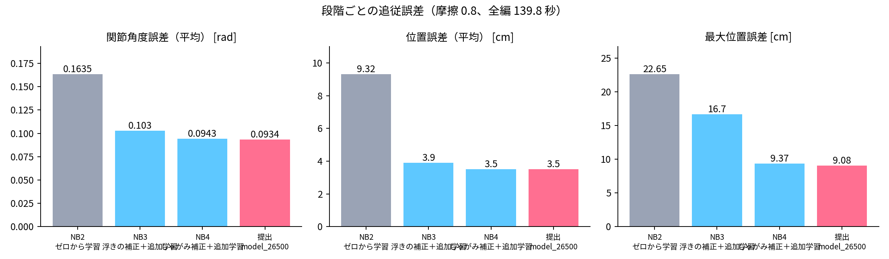

# Unitree G1 による TWICE『The Feels』全編ダンス模倣

単眼のダンス動画（踊ってみた、2 分 19 秒）から全身の動きを推定し、人型ロボット Unitree G1 に、物理シミュレーション（MuJoCo）の中で**全編を転ばずに踊らせる**強化学習の方策を作った。Physical AI 応用編1 最終課題の提出コード一式。

- 動画：https://youtu.be/iIVjBUIauUQ （2 分 58.9 秒、等倍速）
- 実機は使っていない。学習・評価はすべて Google Colab（A100）上のシミュレーション

## 結果

提出用の方策 `model_26500`（摩擦 0.8、全編 139.8 秒）

| 指標 | 最初の方策（ゼロから学習） | 提出 | 変化 |
|---|---|---|---|
| 関節角度誤差（平均） | 0.1635 rad（9.4°） | **0.0934 rad（5.4°）** | −43% |
| 位置誤差（平均、胴体基準） | 9.32 cm | **3.50 cm** | −62% |
| 最大位置誤差 | 22.65 cm | **9.08 cm** | −60% |
| 最大ドリフト（立ち位置のずれ） | 31.2 cm | 18.5 cm | −41% |
| 完走した足裏の摩擦 | 0.5 / 0.8 / 1.0 | **0.5〜1.2 の 6 条件すべて**（1.0 は 6 回とも） | |



## 処理の流れ

```text
単眼動画（30fps に変換）
  → GVHMR：人の 3D 姿勢（SMPL-X、世界座標）              notebooks/01
  → GMR：G1 の 29 関節へリターゲット
  → お手本の補正：推定ミスの補間、ゼロ位相フィルタ、接地補正、しゃがみの補正、物理チェック
  → mjlab + rsl_rl（PPO）：Unitree-G1-Tracking で模倣の方策を学習   notebooks/02〜05
  → 評価（摩擦を固定して全編を 1 体で再生）・正面の比較動画・提出動画
```

## 工夫した点（詳しくは `docs/knowhow.md`）

1. **お手本の「浮き」の発見と解消**：関節は合っているのに位置だけずれる終盤 30 秒を調べ、推定したお手本が約 20 cm 宙に浮いていることを突き止めた（位置誤差との相関 r = 0.92）。接地判定を直して位置誤差 −42%。
2. **物理的に無理なしゃがみの補正**：G1 の体格では届かない深いしゃがみを、区間だけ浅くし、腕のめり込みは肩を開いて逃がす（`scripts/edit_reference.py`）。
3. **報酬の許容幅を段階的に締める追加学習**：学習済みの重みを引き継ぎ、少ない反復で関節誤差 −37%、立ち位置のずれ −47%。
4. **評価の落とし穴の発見**：評価だけで「0.02 秒で転倒」する初期化の不具合をソースで特定。GPU の計算順で境界の結果が変わることを見つけ、摩擦 6 条件と繰り返し評価で頑健な版を選んだ。
5. **見せ方**：正面カメラ、人の推定・お手本・ロボットの 3 画面比較、残像なしの提出動画。

## フォルダの構成

| パス | 中身 |
|---|---|
| `notebooks/` | Colab のノートブック 01〜05（04b は人のメッシュを正面から描き直す）。出力は消してある |
| `scripts/` | お手本の作成・補正（`gvhmr_to_g1_csv.py`、`motion_filters.py`、`edit_reference.py`）、物理チェック（`check_reference.py`）、学習（`train_sim.py`）、評価・動画（`render_policy.py`、`make_comparison.sh`）、解析（`analyze_per_second.py`）、提出物（`make_submission.sh`、`make_part2.sh`、`make_report.py`） |
| `scripts/submission/`、`scripts/report_figs/` | 説明スライドとレポートの図を作るスクリプト |
| `policy/model_26500/` | 提出用の方策のチェックポイント（6.8 MB）と、学習時の設定（`agent.yaml`、`env.yaml`）、使った unitree_rl_mjlab の差分 |
| `results/` | 評価の結果（摩擦スクリーニング、繰り返し評価、最終比較、区間別の誤差）、物理チェック、図 |
| `docs/knowhow.md` | 試行錯誤の記録（何が起きたか → どう原因を絞ったか → どう直したか → 教訓） |

## 動かし方（Google Colab）

1. Google ドライブに `pai_final/` を作り、このリポジトリの `scripts/` を `pai_final/scripts/` に置く。
2. 自分で用意するもの（このリポジトリには含めていない）：
   - 踊っている人の動画（定点・単眼）→ `pai_final/input/`
   - GVHMR の学習済みモデル → `pai_final/gvhmr_ckpt/`（GVHMR の README の手順で入手）
   - SMPL / SMPL-X の体のモデル → `pai_final/models/smpl/`、`models/smplx/`（公式サイトで登録して入手。再配布不可）
3. ノートブックを順に実行する。

| ノートブック | ランタイム | 内容 |
|---|---|---|
| 01 | T4 | 3D 姿勢推定 → リターゲット → お手本（CSV）→ 物理チェック |
| 02 | A100（ハイメモリ） | 学習（全編 20,000 反復、約 9 時間）・評価・比較動画 |
| 03 | A100 | お手本の浮きの補正 → 追加学習 4,000 反復 |
| 04b → 04 | T4 → A100 | 人のメッシュの正面化 → しゃがみの補正 → 追加学習 3,000 反復 → 3 画面比較動画 |
| 05 | A100 | 摩擦スクリーニング → 診断 → 追加学習 → 最終評価 → 提出用の動画 |

- 使った版はノートブックの冒頭で固定している：GVHMR `ee960bb`、GMR `bb1bbe4`、unitree_rl_mjlab `1425b15`、mjlab v1.2.0（`5af32e3`）、MuJoCo 3.5.0 / MuJoCo Warp 3.5.0.2 / Warp 1.12.0。
- 「すべてのセルを実行」でも安全なように作ってある（再開や重い処理は既定で何もしない、済んだ学習・評価は飛ばす）。

### 提出用の方策で評価だけをする

お手本の npz（notebooks/01・03・04 で作る `the_feels_full_g25s.npz`）を用意したうえで、unitree_rl_mjlab のフォルダで実行する。

```bash
REPO=<このリポジトリのパス>
python $REPO/scripts/render_policy.py --task Unitree-G1-Tracking \
  --motion-file src/assets/motions/g1/the_feels_full_g25s.npz \
  --checkpoint $REPO/policy/model_26500/model_26500.pt \
  --friction 0.8 --azimuth 270 --elevation -5 --distance 2.8 --no-ghost --out final.mp4
```

## 含めていないもの

| もの | 理由 |
|---|---|
| 元の動画・提出動画・比較動画 | 他者の映像・楽曲を含む |
| お手本のモーション（CSV / npz）、人の 3D 推定の結果 | 元の動画の人の動きから作ったデータのため |
| SMPL / SMPL-X、GVHMR の学習済みモデル | 各ライセンスで再配布が認められていない |
| 学習ログ・途中のチェックポイント | 大きい（合計 約 670 MB） |

## 謝辞・使用したもの

- [GVHMR](https://github.com/zju3dv/GVHMR)、[GMR](https://github.com/YanjieZe/GMR)、[mjlab](https://github.com/mujocolab/mjlab)、[unitree_rl_mjlab](https://github.com/unitreerobotics/unitree_rl_mjlab)、rsl_rl、[MuJoCo](https://github.com/google-deepmind/mujoco)。それぞれのライセンスに従う。
- お手本の元にした動画：【定点】TWICE「The Feels」踊ってみた（伊原六花さん）。振付の参考：TWICE "The Feels" Choreography Video (Moving Ver.)。
